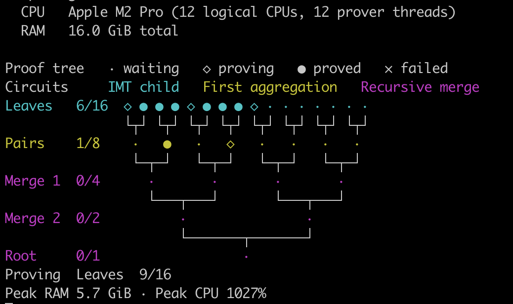

# recursive-imt-prover



A work-in-progress research prover for depth-32 Keccak-256 incremental Merkle
tree (IMT) record replacement. It combines up to 64 independent client proofs
into one proof of an ordered list of roots, input tags and output commitments.

The child uses experimental statistical masking. A formal zero-knowledge
proof for the child and an end-to-end analysis of the 128-bit classical
security target remain open.

## Run the demo

Requires Rust 1.98.1. Run from the repository root.

```sh
cargo prove -n 16 -j 4                      # 16 leaves, up to 4 concurrent proof generations
cargo prove --keep --out run/saved-tree    # Save the default 64-leaf run
cargo prove --verify --out run/saved-tree  # Verify the saved root in a fresh process
```

A parent can start once both input proofs are ready and a proof slot is free.
The terminal shows proof progress, peak RAM and peak CPU. The summary includes
average client and aggregate proof times. Pass `--json` for machine-readable
results. Use independently trusted verifier data when verifying a saved bundle.

## How the tree works

Clients prove membership locally and send the aggregator their proofs and
public statements. First aggregation verifies two client proofs at a time.
Recursive merges then verify two equal-sized subtrees and bind them in
left-to-right order. One merge circuit and key cover every recursive level.

| Circuit | Public inputs | Private inputs (witness) | Shareable output from the prover |
| --- | --- | --- | --- |
| **IMT child** | Merkle root, input tag and output commitment (32 bytes each) | Input and output labels and nonces (32 bytes each), one shared 64-bit quantity, leaf index and 32 sibling hashes | One masked record proof and its public statement |
| **First aggregation** | 32-byte ordered pair digest, leaf count fixed at two, left/right roles, and merge authority | Two masked child proofs, their public statements, and sibling statement digests | One pair proof and the two ordered public leaf statements |
| **Recursive merge** | 32-byte parent digest, total leaf count, left/right roles, and merge authority | Two aggregate proofs, their subtree digests and leaf counts, and sibling subtree digests | One merge proof and the combined ordered list of public leaf statements |

**IMT child.** The client opens an existing record under the public root and
commits to a replacement carrying the same private quantity. The private path
authenticates the input record. Its nonce determines the public input tag.
An application can use that tag to reject repeated use and can append the
output commitment as a new record.

**First aggregation.** The circuit verifies both masked child proofs with the
fixed child verifier. It hashes each child's three public fields into a
statement digest. The left and right verifier instances
must agree on the digest of the ordered pair and on a leaf count of two.

**Recursive merge.** The circuit verifies two aggregate proofs with equal
power-of-two leaf counts. It checks that the public parent count is double
either input count and that the parent digest binds the two subtree digests
and counts in left-to-right order. Inputs covering two leaves use the pinned
first-aggregation key. Larger inputs use the carried merge authority, which
contains the merge verifier's transcript identity and preprocessing commitment.

The aggregator receives proofs and statement data. The three public fields per child
are witness data inside the first aggregation circuit and are also
published in the ordered output list. Aggregation proofs are non-ZK. The final
verifier rehashes that list and checks one root proof under an independently
trusted merge key. [Protocol details](docs/protocol.md) · [Recursive design](docs/aggregation-tree.md)

## Proof sizes and proving time

On the 12-core, 16 GiB MacBook Pro with M2 Pro, aggregating **64 saved child
proofs through fresh root verification took 409.81 s** (6 min 49.8 s).
The previous packed prover took 469.21 s before this run and
398.91 s in a repeat afterward. All three used AC power, the same saved
children, 12 Rayon threads and up to two concurrent parents.
The optimized replay fell between the controls, leaving the full-tree speedup inconclusive.

| Proof | Leaves covered | Median proof size | Median wall time per proof |
| --- | ---: | ---: | ---: |
| Record child (separate preparation run) | 1 | 1.13 MB | 3.51 s |
| First aggregation | 2 | 1.01 MB | 12.19 s |
| Recursive merge | 4–64 | 1.01 MB | 12.44 s |

Parent times overlap. Including key preparation, the optimized tree took
426.12 s. The compressed root was 948,828 bytes and verified in 133 ms
including process launch. The ordered statements and verifier key are separate
files. The isolated 65,536-permutation Keccak proof fell
from 1.343 s to 1.041 s (medians of four trials per build).

The three-minute target requires 2.28× the throughput of this replay.
An earlier packed build completed in 373.38 s on battery and produced the same
root proof. Before the packed chi and joint WHIR changes, the separate-opening
prover took 579.67 s on the same inputs. [Raw AC-powered trials](benchmarks/binary/tree-merge/packed-first-fold-m2.json) · [Earlier replay](benchmarks/binary/tree-merge/joint-packed-parent-m2.json) · [Child preparation](benchmarks/binary/tree-merge/record-replacement.json) · [Performance notes](docs/aggregation-performance.md)

## Proof stack and security

- **Rust and Plonky3** implement the prover and recursive verifiers over
  Poly64 values with Poly192 challenges.
- **Keccak-256 and additive WHIR** provide hashing and polynomial commitments.
  The child proves its Keccak AIR with VEIL-inspired masking.
- **Flock's product bus and committed Keccak GKR** link the recursive
  verifier's arithmetic constraints to its Keccak computations.
  [Implementation map](docs/development.md)

WHIR uses the **Johnson bound** with a safety margin. The child uses a code
rate of 1/16. The recursive prover uses rate 1/2 for its joint arithmetic and Keccak
commitment and for preprocessing. The pinned analysis uses Dao, Kominers,
and Thaler's improved bound within the Johnson regime.
[Security accounting](docs/binary-security.md#parameters-and-accounting)

Dao, Kominers, and Thaler also show that going beyond Johnson can shrink
proofs over fields of sufficiently large characteristic. That makes a
large-characteristic variant worth exploring. The current prover uses binary
fields, where related counterexamples constrain beyond-Johnson proximity
gaps on additive domains. Changing these parameters would require a soundness
argument for the chosen field, domain, and protocol.
[Beyond-Johnson bounds](https://eprint.iacr.org/2026/2056) · [Binary-field counterexamples](https://eccc.weizmann.ac.il/report/2026/237/)

## References

These papers inform the design and its security assumptions.

- [VEIL: Lightweight Zero-Knowledge for Hash-Based Multilinear Proof Systems](https://eprint.iacr.org/2026/683)
  — Dalal, Hemo, Rabinovich and Rothblum. Basis for the masking approach.
- [WHIR: Reed–Solomon Proximity Testing with Super-Fast Verification](https://eprint.iacr.org/2024/1586)
  — Arnon, Chiesa, Fenzi and Yogev. Proximity testing and polynomial commitments.
- [Fractal: Post-Quantum and Transparent Recursive Proofs from Holography](https://eprint.iacr.org/2019/1076)
  — Chiesa, Ojha and Spooner. Transparent recursive proof composition.
- [DEEP-FRI: Sampling Outside the Box Improves Soundness](https://eprint.iacr.org/2019/336)
  — Ben-Sasson, Goldberg, Kopparty and Saraf. Reed–Solomon proximity and STARK soundness.
- [Reed-Solomon Codes Beyond Johnson: Efficient Decoding and Smaller Cryptographic Proofs](https://eprint.iacr.org/2026/2056)
  — Dao, Kominers and Thaler. Improved bounds and their field-characteristic requirements.
- [On Reed–Solomon Proximity Gaps Conjectures](https://eprint.iacr.org/2025/2046)
  — Crites and Stewart. Limits of capacity-based proximity assumptions.
- [Zerocash: Decentralized Anonymous Payments from Bitcoin](https://eprint.iacr.org/2014/349)
  — Ben-Sasson et al. Private membership and public serial numbers in anonymous payments.
